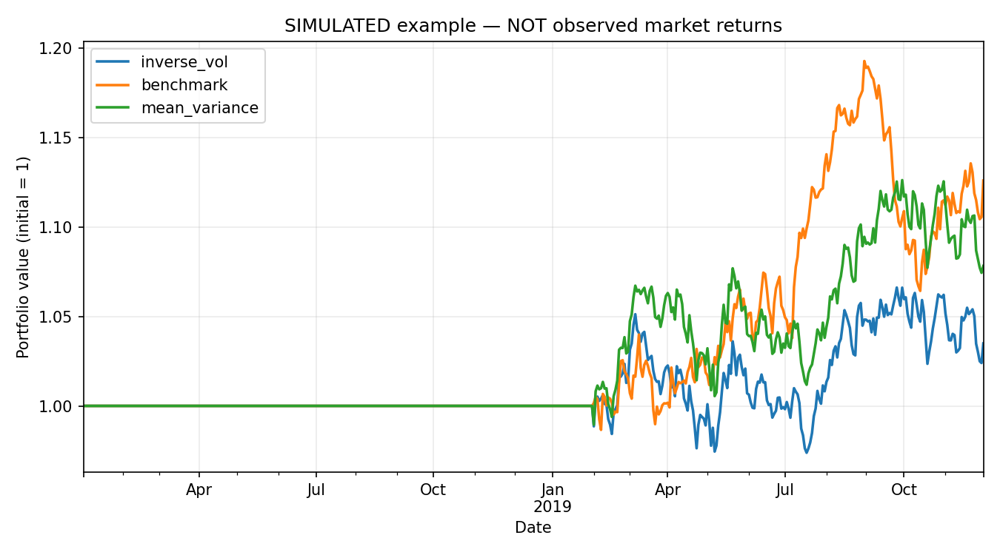

# Professional Quant Factor Backtester

**A reproducible research demonstration of cross-asset factor forecasting and constrained portfolio optimization.**

> **Demonstration data:** The default demo and `example_results/` use **synthetic prices**, not observed ETF histories. Performance figures below illustrate the pipeline and are **not verified historical or investable returns**. See [Data provenance and project history](#data-provenance-and-project-history).

## Research question

Do forecasts of 21-trading-day returns, incorporated into a convex mean–variance optimizer with position bounds, change the performance and turnover of a monthly ETF allocation strategy relative to an inverse-volatility baseline, when both use identical historical information and execution assumptions?

## Key features

- Universe: SPY, QQQ, IWM, TLT, GLD, EFA, EEM, VNQ, XLE, XLK (matching the preserved historical CSV; configurable through CSV input).
- **Nine price factors**: 5/21/63/126-day momentum, 20/60-day moving-average gaps, 21/63-day annualized volatility, 63-day drawdown.
- **Expanding-window Random Forest**: forecasts each ETF's forward 21-day total return at month-end; the training set excludes labels unavailable on the prediction date.
- **Two portfolio configurations**: inverse-volatility weighting and analytic-gradient mean–variance optimization, both long-only, fully invested, and capped at 50% per asset.
- **Multivariable calculus**: explicit gradient, Hessian, finite-difference checks, convexity diagnostic, variance and Euler volatility-risk contributions.
- **Constrained SLSQP** with the analytic gradient; the Hessian is computed and validated independently (SLSQP does not consume it).
- **Next-session execution assumption**: signals generated at close on trading day *t* affect returns beginning at *t+1*, with drift-aware turnover and proportional transaction costs.
- **Verification**: deterministic offline unit tests; a CLI writes CSVs, a comparison PNG, and a derivative audit.
- **Repository organization**: current research code is maintained in `quant_research/`; superseded scripts and historical outputs are retained under `legacy/` for traceability.

## Reproducible demonstration results

These are recorded outputs from the **synthetic-data example** in `example_results/`, not evidence of live or historical ETF strategy performance. Both portfolios are evaluated under the same illustrative data and backtest assumptions; their relative performance may change on other datasets or configurations.



### Backtest summary

| Metric | Inverse-volatility baseline | Constrained mean-variance |
|---|---:|---:|
| CAGR | 4.07% | 9.14% |
| Annualized volatility | 11.34% | 11.95% |
| Sharpe (risk-free rate = 0) | 0.408 | 0.791 |
| Maximum drawdown | -7.36% | -6.04% |
| Total return over example period | 3.49% | 7.82% |
| Total turnover (sum of traded weight) | 14.65 | 16.35 |
| Rebalances | 11 | 11 |

Source: [`example_results/strategy_metrics.csv`](example_results/strategy_metrics.csv). The displayed CAGR and Sharpe values are **synthetic scenario outcomes**, not claims of observed ETF performance.

### Analytical derivative validation

The mean-variance objective uses an analytic gradient and Hessian. A deterministic three-asset numerical check compares these derivatives with finite differences:

| Diagnostic | Recorded result |
|---|---:|
| Maximum gradient absolute error | `1.02448e-11` |
| Maximum Hessian absolute error | `1.10271e-12` |
| Minimum Hessian eigenvalue | `0.20599` |

Source: [`example_results/derivative_check.json`](example_results/derivative_check.json). The positive minimum eigenvalue is for this diagnostic setup; it does not certify every possible input covariance. Tests also check fully invested, long-only, capped portfolio weights and the exclusion of future prices from allocation decisions (`tests/test_optimization.py`).

### Inspect the outputs

- [`equity_curves.csv`](example_results/equity_curves.csv): daily equity paths underlying the illustration.
- [`signal_weights_mean_variance.csv`](example_results/signal_weights_mean_variance.csv): portfolio weights at rebalance signals.
- [`predictions.csv`](example_results/predictions.csv): forecasts and available training cutoffs.
- [`trades_mean_variance.csv`](example_results/trades_mean_variance.csv): portfolio turnover and execution records.

Run the commands in [Get started](#get-started-windows-powershell--macos--linux) to reproduce a demonstration. Its outputs depend on the specified run configuration; archived example files should not be assumed to match changed defaults or random seeds.

## Get started (Windows PowerShell / macOS / Linux)

Requires Python 3.10 or newer. From the extracted project directory:

```bash
python -m pip install -r requirements.txt
python -m pytest -q
python run_demo.py --source synthetic --days 500 --estimators 8 --output example_results
```

The last command should write:

| File | Content |
|---|---|
| `strategy_metrics.csv` | Net CAGR, volatility, Sharpe (zero risk-free rate), max drawdown, total turnover |
| `equity_curves.csv` | Daily portfolio values for both allocators and the benchmark |
| `comparison.png` | Illustration of synthetic equity curves |
| `predictions.csv` | Forecasts and strictly lagged training cutoff dates |
| `signal_weights_inverse_vol.csv` | Inverse-volatility weights at signal close |
| `signal_weights_mean_variance.csv` | MVO weights at signal close |
| `daily_*.csv`, `trades_*.csv` | Daily returns, transaction costs and execution schedule |
| `derivative_check.json` | Maximum finite-difference gradient/Hessian error |
| `DATA_PROVENANCE.txt` | Whether inputs were synthetic or user/vendor supplied |

### Run with historical price data

Supply a wide CSV with **one row per trading date** and adjusted-close ETF prices, e.g.:

```csv
Date,SPY,QQQ,IWM,TLT,GLD
2020-01-02,100.0,100.0,100.0,100.0,100.0
2020-01-03,99.5,99.2,99.0,100.4,100.2
```

The illustration above has too few observations to run a model: **at least about 300+ complete trading dates** are required; 650+ is preferable for a meaningful first evaluation. Run:

```bash
python run_demo.py --source csv --csv adjusted_prices.csv --output results_real
```

The original historical-looking input is preserved at `data/prices.csv`. To run it through the **new** pipeline, after checking its source and adjustment conventions:

```bash
python run_demo.py --source csv --csv data/prices.csv --output results_historical
```

The resulting report is a research backtest with simplified execution assumptions; **do not report its performance as a verified, investable historical return** without checking provenance, market-calendar alignment, and fill/slippage sensitivity. Use `data/DATA_PROVENANCE.md` as a checklist.

For optional Yahoo Finance download (internet required; unverified in this offline environment):

```bash
python -m pip install -r requirements-optional.txt
python run_demo.py --source yahoo --output results_yahoo
```

No API credentials are bundled. A legacy price CSV is included for preservation, but does not by itself establish trustworthy data provenance. An independently documented vendor export is the best basis for research claims.

## Math: what the implementation proves

Let \(\hat\mu_{21}\) be the forecast 21-day returns, \(\Sigma_{21}\) be a covariance estimate for 21-day returns, \(\lambda>0\) control risk aversion, and \(w\) be the vector of asset weights:

\[
\min_w\; f(w)=\tfrac{\lambda}{2}w^\top\Sigma_{21}w-\hat\mu_{21}^\top w,
\qquad \mathbf 1^\top w=1,\quad 0\le w_i\le 0.5.
\]

Analytically,

\[
\nabla_w f(w)=\lambda\Sigma_{21}w-\hat\mu_{21},
\qquad \nabla_w^2 f(w)=\lambda\Sigma_{21}.
\]

The covariance is estimated from at most the preceding 63 complete daily returns and multiplied by 21. This scaling **assumes negligible serial correlation** and is only an approximation. Diagonal covariance shrinkage is applied to reduce estimation noise. With \(\Sigma_{21}\) positive semidefinite, the continuous objective is convex; a feasible full-investment, bounded solution can be found using SLSQP.

The implementation explicitly checks the analytic gradient and Hessian against finite differences (see `quant_research/diagnostics.py`). See [Mathematical Notes](docs/MATHEMATICAL_FOUNDATIONS.md) for KKT conditions and limitations.

**Scope:** This implementation demonstrates partial differentiation, matrix calculus, Hessians, and constrained optimization within the stated numerical model.

## Project structure

```text
quant_research/
  config.py          parameter defaults
  data.py            validated CSV, optional Yahoo, synthetic demo
  factors.py         nine factors and 21-day target construction
  model.py           expanding-window, embargoed monthly forecasts
  portfolio.py       capped inverse-vol baseline / MVO selector
  optimization.py    objective, gradient, Hessian, MVO optimizer
  diagnostics.py     finite differences, Euler risk contributions
  backtest.py        next-session, cost-aware portfolio simulation
  metrics.py         CAGR, Sharpe, max drawdown, volatility
run_demo.py           command-line end-to-end pipeline
examples/             derivatives demo
example_results/      one synthetic sample run, clearly labeled
tests/                automated research/math tests and test instructions
docs/                 mathematical foundations and methodology limitations
data/prices.csv        preserved historical-looking input, provenance unverified
legacy/               archived scripts, historical tests and preserved old results
.github/workflows/    GitHub Actions test workflow and CI notes
```

## Bias controls, assumptions, and limitations

1. Signals use only current/past closes. Each training label is included only after its full 21-day outcome is observed (`training_cutoff` is at most signal index minus 21 sessions).
2. Signals are computed **after** the signal day's close. Returns attributable to any target start the following session. The backtest assumes next-session execution at **the previous close**: this is an idealized timing assumption, **not** evidence of achievable fills. Real execution should use next-session opens/quotes and slippage.
3. ETF returns assume adjusted closing prices; missing data are rejected rather than silently forward-filled. The implementation does not model borrow, spreads, taxes, market impact, intraday gaps, exchange calendars, ETF inception/survivorship changes, or interest on cash.
4. The strategy is long-only and fully invested after the first rebalance, with a maximum single-ETF allocation of 50%. All selected predicted returns may be negative; it still invests fully.
5. The annualization factor is 252 and the Sharpe calculation uses a zero risk-free rate. Benchmark SPY is shown without buy-side execution costs; allocator turnover includes entry and later rebalances.
6. Random Forest forecasts are noisy; portfolio optimization is sensitive to estimated returns/covariance. Out-of-sample results must be independently checked and may be worse than the baseline.
7. The sample synthetic generator uses weekdays, not an actual exchange holiday calendar. Sample performance is pedagogical only.
8. `legacy/results/` and `legacy/results_original_github/` preserve earlier output artifacts. Do not mix those figures with outputs of the current SLSQP mean-variance pipeline. The older tests and entrypoints are archived rather than silently rewritten.

## Data provenance and project history

This repository is an **independently runnable reconstruction** of an earlier factor-backtesting project, extended with an integrated 21-day constrained mean-variance allocation workflow. It is not represented as a line-by-line modification of an inaccessible upstream repository. Earlier scripts and outputs are retained under `legacy/` for traceability.

The default demo uses synthetic prices. The preserved `data/prices.csv` contains a historical-looking 2010–2023 ETF price table from the older project, but its vendor, adjustment conventions, and provenance have **not been independently verified**. Files under `legacy/results/` and `legacy/results_original_github/` are archived outputs, **not results from the current optimization pipeline**. Do not combine those historic-looking outputs with the current synthetic demonstration or present them as verified live-market performance.

For implementation and data caveats, consult [Mathematical Foundations](docs/MATHEMATICAL_FOUNDATIONS.md), [Methodology and Limitations](docs/METHODOLOGY_AND_LIMITATIONS.md), and the [Data Provenance Checklist](data/DATA_PROVENANCE.md). Run `python -m pytest -q` before reporting new results.
